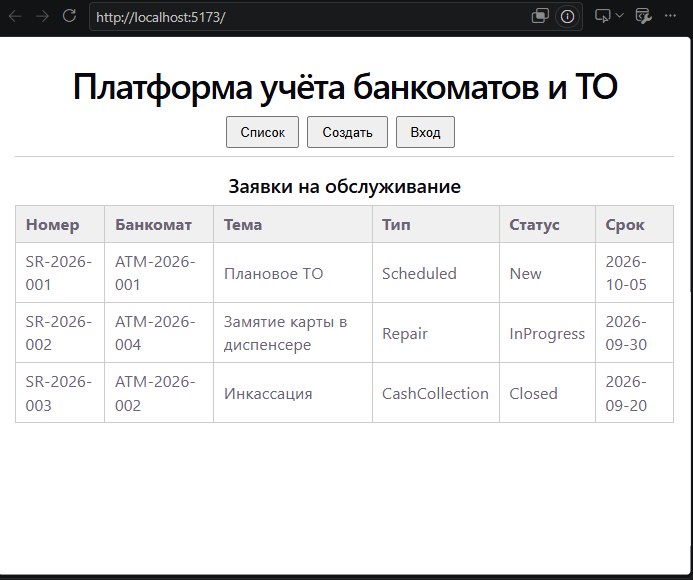
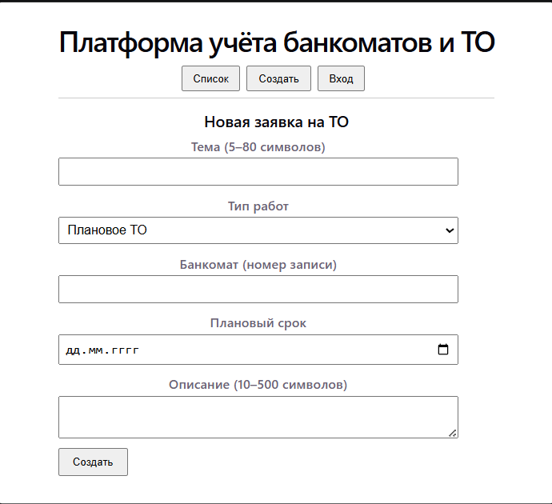
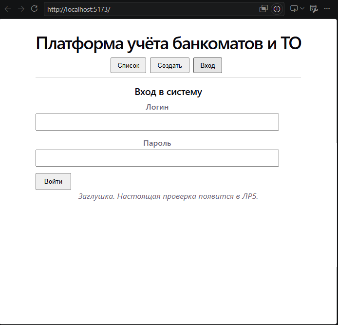

# Чеклист семантики и доступности (ЛР3)

| № | Проверка | да/нет |
|---|---|---|
| 1 | Есть `<main>` на рабочих экранах | да |
| 2 | Форма создания обёрнута в `<form>` | да |
| 3 | У каждого поля есть `<label>` (через for/id) | да |
| 4 | Список — `<table>` | да |
| 5 | При открытии формы фокус на первом поле (autofocus) | да |
| 6 | Стили в `scoped`; макет читаемый | да |
| 7 | Поля и статусы читаются | да |

## Критерий 
Критерий 1 ЛР1 («создать банкомат / заявку») закрывают поля:
`title`, `type`, `atmId`, `dueDate`, `description` в форме «Создать».

