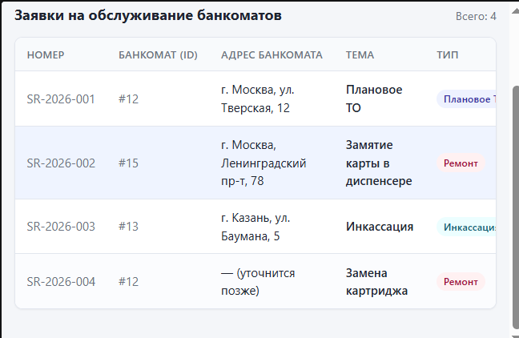
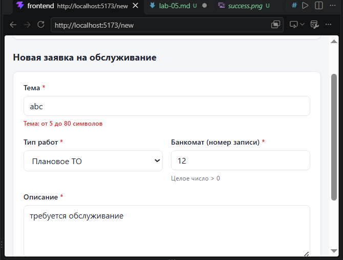
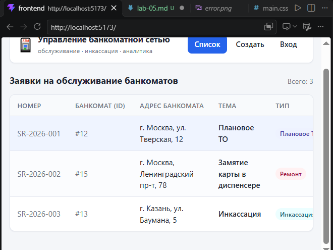

# Отчет по лабораторной работе №5
## Vue 3: форма и список в памяти

**Цель:** Связать форму с общим массивом данных. Проверить сценарии добавления валидной записи, отказа при невалидных данных и очистки памяти после перезагрузки страницы (F5).

### 1. Что было сделано
- Создан общий модуль `frontend/src/ticketsStore.js`, содержащий реактивный массив `items`, счетчик `nextId` и функцию `addItem`.
- Обновлен компонент формы `RequestNew.vue`. В нем настроены:
  - двустороннее связывание `v-model`;
  - приведение типа для ID банкомата через `v-model.number`;
  - перехват отправки формы через `@submit.prevent` (защита от перезагрузки страницы);
  - клиентская валидация (тема 5–80 символов, `atmId` > 0, описание 10–500 символов) с выводом ошибок.
- Обновлен список `RequestList.vue` для импорта данных из общего хранилища.

### 2. Результаты проверки (3 доказательства)

| Проверка | Что делаю | Факт |
| :--- | :--- | :--- |
| **Успех** | Ввожу тему «Замена картриджа» (≥5 симв.), банкомат `12`, описание ≥10 симв. | Форма очищается, происходит переход на `/`. В таблице появляется новая строка со статусом `New`. |
| **Отказ** | Ввожу тему «abc» (3 символа), остальные поля корректно. Нажимаю «Создать». | Перехода нет. Под полем «Тема» появляется красная ошибка: «Тема: от 5 до 80 символов». Запись не добавляется. |
| **Память (F5)** | После успешного создания записи нажимаю F5 в браузере. | Добавленная строка исчезает. *Ожидаемо: сервера и БД пока нет, данные хранятся только в памяти браузера.* |

### 3. Скриншоты

*(Сюда нужно вставить картинки. Пример ниже)*

**Успешное добавление:**

**Отказ при короткой теме:**

**После перезагрузки страницы (F5):**

### 4. Ответы на контрольные вопросы
1. **Зачем нужен `.prevent`?**
   Без него браузер перезагрузил бы страницу при отправке формы (по умолчанию в HTML), и состояние Vue-приложения сбросилось бы. `.prevent` отменяет стандартное поведение.
2. **Почему у `atmId` нужен `.number`?**
   HTML-инпут `type="number"` возвращает строку (`"12"`). Модификатор `.number` заставляет Vue привести это значение к числу (`12`), чтобы валидация и отправка работали корректно.
3. **Где хранится массив?**
   В файле `frontend/src/ticketsStore.js`. Это позволяет разным экранам (форме и списку) обращаться к единому источнику данных.
4. **Почему F5 очищает новые записи?**
   Данные хранятся в оперативной памяти (JavaScript-переменные). При перезагрузке страницы приложение запускается с нуля, и массив инициализируется исходными тестовыми данными.