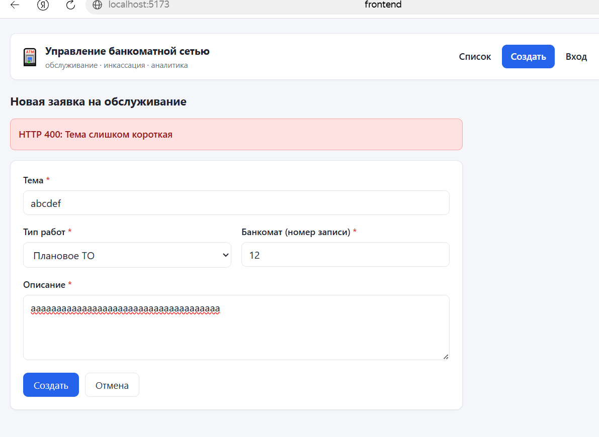
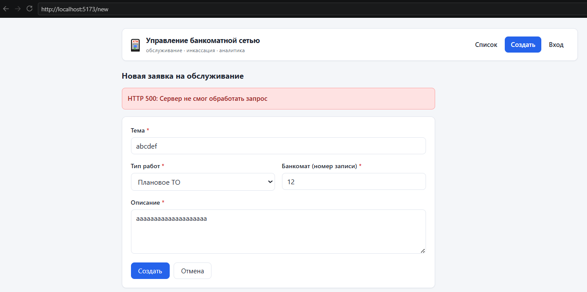
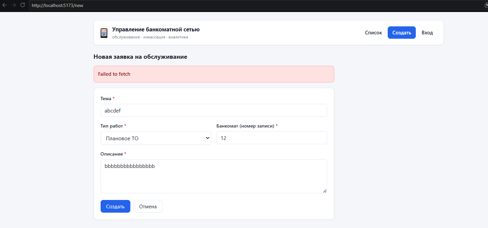

# Отчет по лабораторной работе №6
## Vue 3: клиент API и mock

**Цель:** Отделить интерфейс от источника данных, переведя список и форму на вызовы API-модуля. Реализовать состояния загрузки, пустого списка, данных и ошибки. Исключить создание дубликатов при двойном клике и настроить переменные окружения.

### 1. Что было сделано

1. **Настройка окружения:**
   - Создан файл `frontend/.env` (добавлен в `.gitignore`).
   - Создан файл `frontend/.env.example` с переменной `VITE_API_BASE_URL=http://localhost:5000`.

2. **Реализация Mock-сервера (`src/api/mockTickets.js`):**
   - Написаны функции `mockGetTickets` и `mockCreateTicket` с искусственной задержкой 500 мс.
   - Реализована имитация серверных ответов: `200` (успех), `400` (ошибка валидации), `500` (внутренняя ошибка по флагу).
   - ID и номер заявки (`number`) генерируются на стороне "сервера" (mock) и возвращаются в ответе.

3. **Создание API-клиента (`src/api/tickets.js`):**
   - Написан единый интерфейс: функции `getTickets()` и `createTicket(body)`.
   - Добавлен переключатель `USE_MOCK` (сейчас `true`), чтобы страницы не зависели от источника данных.
   - Для реальной ветки используется встроенный `fetch` с проверкой `response.ok`.

4. **Обновление UI:**
   - Экран списка (`RequestList.vue`) переведен на единое состояние `state` (`loading` | `empty` | `data` | `error`). Данные загружаются асинхронно через `onMounted`.
   - Форма (`RequestNew.vue`) переведена на вызов `createTicket`. Добавлен флаг `isSubmitting` для блокировки кнопки во время отправки. Созданный объект берется из ответа.

---

### 2. Тестирование отказов и защита от дублей

В ходе работы были проверены три сценария ошибок (путем переключения флагов в `tickets.js`):

| Сценарий | Как воспроизвести | Сообщение в UI |
| :--- | :--- | :--- |
| **Ошибка 400 (Bad Request)** | Ввод темы короче 5 символов. | «HTTP 400: Тема слишком короткая» |
| **Ошибка 500 (Server Error)** | Включить флаг `TEST_FORCE_500 = true` в `tickets.js`. | «HTTP 500: Сервер не смог обработать запрос» |
| **Нет связи (Network)** | Выключить `USE_MOCK` (false), выключить бэкенд. | «Failed to fetch» (обрабатывается в блоке catch) |

*Защита от дублей:* при отправке формы кнопка блокируется через `:disabled="isSubmitting"` и меняет текст на «Создаём...». Повторный клик игнорируется благодаря раннему `return` в начале функции `onCreate`.

---

### 3. Скриншоты

*(Вставьте сюда свои скриншоты)*

**Состояние загрузки (задержка mock):**

**Запросы в Network (создание заявки):**

**Ошибка сервера (флаг force500):**

---

### 4. Ответы на контрольные вопросы

1. **Почему 400 не попадает в catch?**
   `fetch` не считает ответы с кодами 4xx и 5xx «сетевыми ошибками» — запрос ведь дошел до сервера и сервер ответил. В `catch` попадает только физическая невозможность выполнить запрос (нет сети, сервер выключен). Поэтому ответы 400/500 нужно проверять вручную через `if (!response.ok)`.
2. **Чем 500 отличается от отсутствия сети?**
   500 — это ответ сервера (сервер работает, но внутри него произошла ошибка). Отсутствие сети — это когда ответа вообще нет (сервер недоступен, выключен или неверный URL). В первом случае мы получаем `response.ok === false`, во втором — вылетает исключение в `catch`.
3. **Откуда берутся id и number?**
   В ЛР6 они берутся из ответа Mock-сервера (который имитирует реальную БД). В будущем (при подключении C#) их будет генерировать база данных на сервере, а клиент просто отобразит то, что пришло в JSON.
4. **Зачем блокировать кнопку во время POST?**
   Чтобы предотвратить создание дубликатов. Пользователь может случайно нажать кнопку дважды (или кликнуть несколько раз из-за задержки сети), и без блокировки на сервер уйдут два одинаковых запроса, создав две заявки.